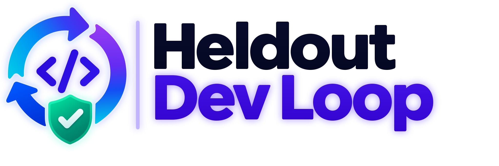
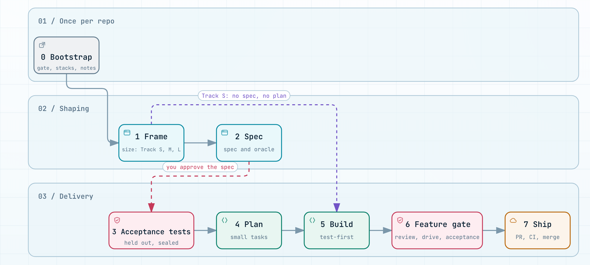

<h1 align="center">
  <picture>
    <source media="(prefers-color-scheme: dark)" srcset="assets/logo-dark.svg">
    
  </picture>
</h1>

[](https://github.com/tayebchlyah/heldout-dev-loop/actions/workflows/ci.yml) [](LICENSE)

A stage-driven development loop for Claude Code and Codex, where the acceptance tests are written from the spec and held out from the agent that writes the code.

The repository is `heldout-dev-loop`. The kit it installs keeps the name `dev-loop`: the `dev-loop` skill, `dev-loop.json`, `.dev-loop/` and `devloop.py`.

## What and why

dev-loop is a skill, a set of subagents and hooks, and an installer. It takes a coding agent from a request to a merged pull request through fixed stages: frame the work, write a spec, write acceptance tests, plan, build, review, ship.

An agent that writes both the code and its tests grades its own work: when a test fails, it can change the test instead of the code. dev-loop splits the two. A separate agent writes the acceptance tests from the approved spec alone, before any code exists. The agents that write the code never read those tests, and hooks enforce it. The tests are a held-out set, as in machine learning: the code passes them only if it does what the spec says.

The rest of the loop keeps the agent honest in the same way: three reviewers and a reviewer from the other model family read the whole branch, a decision log records each choice the agent made alone, and a fixed list of events stops the agent and waits for you.

## The loop

<picture>
  <source media="(prefers-color-scheme: dark)" srcset="assets/the-loop-dark.png">
  
</picture>

- **0 Bootstrap**: once per repository: the gate script, the stacks, the notes folder.
- **1 Frame**: a grilling session sizes the work as Track S, M or L.
- **2 Spec**: the spec, its acceptance oracle and the earlier lines it supersedes. You approve it.
- **3 Acceptance tests**: `spec-tester` writes the held-out suite from the spec and seals it.
- **4 Plan**: a planner subagent writes a plan of small tasks.
- **5 Build**: test-first, task by task, in the feature worktree.
- **6 Feature gate**: review wave, triage, fix wave, a drive of the real app, the acceptance loop.
- **7 Ship**: push, pull request, CI, then a merge or a wait for you.

## Quick start

From the top level of a git repository:

```bash
npx github:tayebchlyah/heldout-dev-loop#<tag> init
```

Use a release tag, for example `v3.0.0`. Flags and the other commands are in [docs/usage.md](docs/usage.md). Commit the result, then check the install for each harness you use:

```bash
python3 .agents/skills/dev-loop/scripts/check_setup.py --harness claude --repo .
python3 .agents/skills/dev-loop/scripts/check_setup.py --harness codex --repo .
```

Then start a session in the repository and describe the work. The SessionStart hook loads the `dev-loop` skill, and `devloop.py status` picks the stage. Three steps need you once ([docs/usage.md](docs/usage.md), After installing): trust the hooks in Codex with `/hooks`, install Matt Pocock's skills for Codex, and install the `security-audit` skill.

## How it works

### Tracks

Stage 1 sizes the work.

- **Track S**: a small change. No spec and no plan: build, the review wave, ship.
- **Track M**: a spec, a plan, then an inline build in the same session.
- **Track L**: a spec with a threat model, a plan, then one fresh implementer subagent per task. Never merged without you.

### Shaping and Delivery

A Track M or L feature runs in one session by default, in two parts. **Shaping** (Stages 1 and 2, high effort, on `main`) ends when you approve the spec. **Delivery** (Stages 3 to 7, medium effort) runs in the feature's own git worktree and branch. A new session is optional: `/pause` writes a pause note, `/continue` takes over from it, also after a usage limit or in the other harness.

### The held-out suite and its seal

`spec-tester` reads the spec and the glossary, never the source code, and writes `tests/acceptance/`. It commits with `devloop.py seal`, which adds trailers with a hash of the suite. After that commit the suite is frozen: only `spec-tester` changes it, and only when the spec oracle changes. `seal-check` runs in the gate and in the Stop hooks and finds any other change. A transcript audit at SubagentStop records a taint when a subagent read a file it must not read; the work of a tainted implementer is reverted.

### The walls

Hooks deny, per agent role: a read, an edit or a search of the held-out suite by an implementer; a write in `tests/acceptance/` by the main session; an edit of an installed kit file; and a risky git or gh command (a push to `main`, a force push, a tag push, a `gh api` write) unless you allow it. The Claude Code and Codex walls differ; each harness reference lists its own gaps.

### The feature gate

Stage 6 runs once per feature, at one commit:

1. **Review wave**: three reviewers (correctness, spec, standards) whole branch, one table each. A second reviewer of the other model family (Codex for Claude Code, Claude for Codex) is optional and off by default: it runs when the project and the user both turn it on (see [configuration](docs/configuration.md)).
2. **Triage**: the tables merge by file and line. Each security finding goes to a verifier. Only a confirmed defect must be fixed; the rest goes to a weekly review list.
3. **Fix wave**: one fresh implementer per group of files.
4. **Drive**: in a project with a UI, the verify skill drives the changed routes in Chromium and keeps screenshots.
5. **Acceptance loop**: the held-out suite runs, and each failure is classified as product, test or environment before the next round. A round must reduce the failing count, or the loop stops.

### The autonomy grant

In Delivery the agent does not ask questions. It runs a command, a test or a read to answer them, makes the open decision, and logs it with `devloop.py decide` in the spec's decision log. It stops only for a fixed list: a gate red after three fix rounds, a one-way decision the spec does not cover, an action that deletes data or reaches production, a tag push, a conflict with an earlier spec, and a few more. `devloop.py merge-check` decides whether the pull request may merge without you. The final report lists each risky decision first.

## Usage

Start a session in a project and say what you want. dev-loop runs the stage `status` gives. Each stage ends with a direct gate, so the next stage starts from green.

- `/pause` and `/continue`: stop the work now, and take it over later, in this or another session or harness.
- `/release-audit`, then `/release`: the security audit of a release, and the release itself.
- `/garden`: the weekly review of the findings that were not fixed.

The `devloop` command does the deterministic work, as `python3 .agents/skills/dev-loop/scripts/devloop.py <command>`, with one JSON object on stdout. Some of its commands:

- `status`: the stage of the work and the next action.
- `gate --summary`: the project gate, with its failures, the seal check and the size check.
- `size-check`: fails a new or grown file above 40,000 bytes and names where to split it.
- `review-merge`: merges the Stage 6 reviewer tables into one row per file and line.
- `acceptance [--failed]`: runs the held-out suite through `commands.acceptance` and gives the progress guard verdict. This repository maps `commands.acceptance` to `scripts/acceptance.sh`.
- `ci wait`, `merge-check`: the Stage 7 CI verdict and merge decision.

All commands: [docs/commands.md](docs/commands.md). Install, verify and backups: [docs/usage.md](docs/usage.md).

## Configuration

`dev-loop.json` at the top of the repository holds the kit `version` and the `harnesses`, and optional keys: `commands` (your own gate, stack and acceptance commands), `merge` (`auto` or `human`), `merge_human_paths`, `verify` and `security_audit`. See [docs/configuration.md](docs/configuration.md).

The feature notes (framing, spec, plan, decision log) live in a notes folder outside the repository, any local folder, for example an Obsidian vault. Each person sets its path in the gitignored `dev-loop.local.json`. A team can commit a path in `dev-loop.json` instead.

Upgrade, rollback and the breaking changes of each version: [docs/upgrade.md](docs/upgrade.md).

## Inspirations and credits

dev-loop takes ideas and text from these projects. **Invoked**: installed apart and called at run time. **Adapted**: text copied and changed, with a Source line in the kit file. **Idea**: no text taken.

| Part | Idea | Source | Relation | Kit file |
| --- | --- | --- | --- | --- |
| Stage 1 framing | A relentless question round before any spec, and a throwaway prototype for UI work | Matt Pocock skills (`pocock-skills`) `grilling`, `prototype` | invoked | - |
| Spec seam rule | Test at the highest existing seam, ideally one | `pocock-skills` `to-spec` | adapted | `skill/references/spec.md` |
| Feature maps | A map of features with local issue files for an effort larger than one feature | `pocock-skills` `setup-matt-pocock-skills` (local issue tracker) | adapted | `skill/references/maps.md` |
| Test seams | The interface is the test surface | `pocock-skills` `codebase-design` | adapted | `skill/references/tests.md` |
| Build and review skills | Test-first, diagnosis, PR body, code review, domain terms | `pocock-skills` `tdd`, `diagnosing-bugs`, `pr`, `code-review`, `domain-modeling`, `wayfinder` | invoked | - |
| Spec builder check | A fresh agent lists what it would have to guess to build from the spec | Superpowers (`superpowers`) `brainstorming` builder check prompt | adapted | `skill/references/spec.md` |
| Plan and execution | Small planned tasks, executed inline or by one subagent per task | `superpowers` `writing-plans`, `executing-plans`, `subagent-driven-development` | invoked | - |
| Track L threat model | Trust boundaries, assets and STRIDE before hardening | Addy Osmani agent-skills (`agent-skills`) `security-and-hardening` | adapted | `skill/references/spec.md` |
| Doubt review | An adversarial reviewer gets the artifact and the contract, never the claim | `agent-skills` `doubt-driven-development` | adapted | `skill/references/spec.md` |
| Code volume rules | Write less code, change only what the request needs | Ponytail (`ponytail`) `AGENTS.md` | adapted | `skill/references/building.md` |
| Building principles | Prove it works, fix root causes, attack the premise | pstack (`pstack`) principle skills | adapted | `skill/references/building.md` |
| Merge danger ladder | Prove the one fact a risky change is safe because of | `pstack` `blast-radius` | adapted | `skill/SKILL.md` |
| Benchmark checklist | Write the claim and the noise floor before you measure | `pstack` `benchmark-checklist` | adapted | `skill/references/benchmark.md` |
| Verify skill | A project skill that launches, drives and cleans up the real app | `pstack` `create-verification-skill` | adapted | `skill/references/verify.md` |
| Codex macOS sandbox | The Seatbelt policies that confine a Codex hook | OpenAI Codex (`codex-sandbox`) Seatbelt policies | adapted | `codex/hooks/macos_policy.py` |
| Security review and release audit | A vulnerability verifier prompt and a full audit workflow | Cloudflare (`security-audit`) | invoked | - |
| Held-out suite | Tests the builder never sees, as the held-out test set of machine learning | the held-out test set of machine learning | idea | - |

Credits:

- `pocock-skills`: [https://github.com/mattpocock/skills](https://github.com/mattpocock/skills), MIT, v1.3.2. Framing, seams, maps and the build and review skills.
- `superpowers`: [https://github.com/obra/superpowers](https://github.com/obra/superpowers), MIT, 7.0.1. The builder check and the plan and execution skills.
- `agent-skills`: [https://github.com/addyosmani/agent-skills](https://github.com/addyosmani/agent-skills), MIT, 0.6.15. The threat model and the doubt review.
- `ponytail`: [https://github.com/DietrichGebert/ponytail](https://github.com/DietrichGebert/ponytail), MIT, v5.3.3. The code volume rules.
- `pstack`: [https://github.com/cursor/plugins/tree/main/pstack](https://github.com/cursor/plugins/tree/main/pstack), MIT (`pstack/LICENSE`), 0.15.36. The principles, the merge danger ladder, the benchmark checklist and the verify skill.
- `codex-sandbox`: [https://github.com/openai/codex](https://github.com/openai/codex), Apache-2.0, rust-v0.166.0. The Seatbelt policies; license and NOTICE in `skill/references/licenses/Codex Sandbox.txt`.
- `security-audit`: [https://github.com/cloudflare/security-audit-skill](https://github.com/cloudflare/security-audit-skill), MIT, pinned commit `c1c8a8c1471069fb0e188eeaff69b8e8db6564a8`. The Stage 6 security verifier and `/release-audit`.

The vendor text under `## Scope, Claude Code` and `## Scope, Codex` in `skill/references/building.md` comes from the Anthropic Claude prompting docs (https://platform.claude.com/docs/en/build-with-claude/prompt-engineering/prompting-claude-fable-5-1 and https://platform.claude.com/docs/en/build-with-claude/prompt-engineering/prompting-claude-sonnet-5-5) and the OpenAI Codex docs (https://developers.openai.com/api/docs/guides/latest-model).

The copied license texts are in `skill/references/spec.md`, `building.md`, `verify.md` and `skill/references/licenses/`. `scripts/upstream_watch.py` checks these sources each week (`.github/workflows/upstream-watch.yml`) and keeps one `upstream-watch` issue open with what changed.

## Security model and limits

- The walls and the seal stop a careless agent, not a hostile agent or a hostile user.
- The hooks run on your machine with your rights, with one exception: on Codex, the feature gate hook runs under native Codex confinement (a Seatbelt adapter on macOS). The other Codex hooks, and every Claude Code hook with the gate it starts, run on the host.
- The known gaps are listed in `skill/references/claude.md` and `skill/references/codex.md`.
- Each release has a security audit, and an open security finding makes `release-check` refuse the tag in `/release`, and the git guard refuses the tag push. An admin can still push a tag by other means.

Report a vulnerability as [SECURITY.md](SECURITY.md) says.

## Contributing

Open an issue first and wait for a go before a pull request. The rules, the gate and the commit format are in [CONTRIBUTING.md](CONTRIBUTING.md). Everyone follows the [Code of Conduct](CODE_OF_CONDUCT.md).

## License

MIT, see [LICENSE](LICENSE). The kit ships the same text as `LICENSE.txt` in the skill folder.
